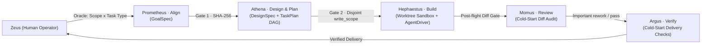

# Olympus4SWE

English | [简体中文](README.zh-CN.md)

**A first-principles, Agent-Native full-lifecycle software engineering system.**

Olympus4SWE pairs a **deterministic SDLC control plane** (Python 3.13 + SQLite WAL + FastAPI) with a **pluggable execution meta-harness** (built-in `native` loop + external `Pi` coding agent driver) and a two-layer **Oracle Board + Ariadne** web workbench.

> **Core invariant:** LLMs propose specifications, plans, code, tests, and review findings. Deterministic code owns state transitions, SHA-256 hash-bound approvals, disjoint `write_scope` DAG validation, post-flight `Diff Gate` checks, monotonic budget ledgers, and bounded rework convergence.

---

## Why Olympus4SWE

Olympus4SWE is designed from first principles around four irreducible failure modes in agentic software engineering—without adopting opaque, black-box orchestration frameworks:

1. **Ambiguous intent → building the wrong system**: Stage 1 (`Align`) inspects the repository read-only, surfaces blocking ambiguities (with optional cold-start parallel critiques), and freezes a human-approved EARS `GoalSpec` with explicit `out_of_scope` boundaries before code is written.
2. **Long-horizon context rot & concurrent write collisions**: Stage 2a (`Design`) locks white-box module boundaries and interface seams (`DesignSpec`), while the planner emits a validated Task DAG with strictly disjoint `write_scope` assignments executed in isolated `git worktree` sandboxes and verified by a post-flight `Diff Gate`.
3. **Self-review confirmation bias**: Cold-start `Momus` (code review) and `Argus` (independent verification) inspect diffs and executable check outputs against frozen contracts with **zero shared conversation history** with the implementer, grading `Important` vs. `Nit` defects under bounded rework limits (`max_cycles=3`).
4. **Black-box runs that are hard to monitor or steer**: Every state transition, milestone, diff, delivery check, and human ruling is recorded in an append-only SQLite event store projected live over SSE, while operators can issue mid-turn `steer` guidance or pause safely without discarding work.

---

## The Olympus Pantheon & Pipeline



| Role | Responsibility |
| :--- | :--- |
| **Zeus** *(Human)* | Issues **Oracles** scoped to a workspace (`brownfield` / `greenfield` / `spec_only` × `feature` / `fix` / `refactor` / `blueprint`), answers clarifications, and approves hash-bound gates. |
| **Prometheus** *(Align)* | Gathers read-only repository evidence, surfaces blocking ambiguities, and freezes the human-approved `GoalSpec`. |
| **Athena** *(Design & Plan)* | Authors the white-box `DesignSpec` (modules, data models, interfaces) and decomposes work into a validated dependency `TaskPlan` DAG. |
| **Hephaestus** *(Build)* | Implements each `TaskNode` inside an isolated sandbox via its configured `AgentDriver` (`auto`, `pi`, or `native`). |
| **Momus** *(Review & Audit)* | Cold-start diff reviewer classifying `Important` vs. `Nit` defects and enforcing bounded convergence. |
| **Argus** *(Verify)* | Cold-start read-only verifier auditing sandbox diffs and isolated delivery checks against frozen upstream contracts. |

The **Web Workbench** exposes two coordinated surfaces over the same SQLite event stream:
- **L1 · Oracle Board**: Multi-workspace switching, Ball-in-Court columns (`Awaiting Your Ruling` · `In Flight` · `Delivered`), inline **Quick Ruling Drawer** for clarifications/approvals, and the pinned five-seat **Pantheon Dock**.
- **L2 · Ariadne Cockpit**: Deep-dive tabs per Oracle featuring dual live topologies (Workflow Graph + Task DAG via React Flow + ELK), hash-bound contract diff reviews, task matrix, event waterfall, and resizable inspector dock.

---

## Quick Start

### Prerequisites

- **Python 3.13+**, [`uv`](https://docs.astral.sh/uv/), and **Git**
- **Node.js 22+ & `pnpm`** *(optional — only needed when developing `web/`; runtime `olympus serve` serves pre-built static assets with zero Node requirement)*
- **Pi CLI** *(optional — enables the external `pi` agent driver when `auto` detects it)*

### 1. Install

```bash
git clone https://github.com/kyrie21z/Olympus4SWE.git
cd Olympus4SWE
uv sync --locked
```

### 2. Configure an LLM Provider

Olympus4SWE isolates vendor SDKs behind a data-driven `ProviderRegistry` and sticky-failover `CredentialPool`. Set standard environment variables for the built-in `openai` or `anthropic` providers:

```bash
# OpenAI or any OpenAI-compatible gateway
export OPENAI_API_KEY="sk-..."
# Optional overrides:
# export OPENAI_BASE_URL="https://your-gateway.example/v1"
# export OLYMPUS_MODEL="gpt-4o-mini"

# Or Anthropic
export ANTHROPIC_API_KEY="sk-ant-..."
# export ANTHROPIC_BASE_URL="https://api.anthropic.com"
```

For custom OpenAI-compatible / Anthropic gateways, multi-key pools (`api_keys_env`), custom headers, or default model overrides, add a JSON registry file at `~/.olympus/providers.json`, `<repo>/.olympus/providers.json`, or the path in `OLYMPUS_PROVIDERS_FILE`:

```json
{
  "providers": {
    "my-gateway": {
      "dialect": "openai-chat",
      "default_model": "my-model",
      "base_url": "https://gateway.example/v1",
      "api_key_env": "MY_GATEWAY_API_KEY",
      "default": true
    }
  }
}
```

### 3. Launch the Web Workbench

```bash
uv run olympus serve
```

Open **`http://127.0.0.1:8765`** to use **Oracle Board** and **Ariadne** (pass `--host`, `--port`, `--workspace /path/to/repo`, or `--db` to customize).

---

## Workflows, CLI & Headless Sessions

### Built-in Declarative Workflows

Workflows live as data-only YAML definitions in `src/olympus/graph/workflows/` and can be inspected with `uv run olympus workflows`:

| Workflow | Topology | Gates | Purpose |
| :--- | :--- | :--- | :--- |
| `full_sdlc_tdd` | `tdd_first` | Human-controlled | Full SDLC (`intake → align → critic → design → plan → execute`) using TDD-first vertical tracer-bullet slicing. |
| `product_blueprint` | `modular_product` | Human-controlled | Produces frozen `GoalSpec`, white-box `DesignSpec`, and Wave 0/1/2 `TaskPlan`, stopping after plan approval (`stop_after: plan`). |
| `repo_fast_patch` | `minimal_patch` | Auto-satisfied | Compact single-wave patch loop designed for small repository fixes, CI, and scripted runs. |

### Headless Pause-and-Resume Session CLI

For scripts, CI, or external agent benchmarks, `olympus session` emits a single machine-readable `SessionEnvelope` JSON (`status`: `needs_input | completed | failed`, `pause_kind`: `clarify | approval | blocked | plan_handoff`):

```bash
# Start a workflow run against a target repository
uv run olympus session start "Add a /healthz JSON endpoint with tests" \
  --workspace /path/to/repo \
  --workflow full_sdlc_tdd

# Continue a paused run with a natural-language clarification, approval, or revision
uv run olympus session reply <run_id> "Approve the spec; keep auth out of scope."
```

Useful flags: `--step-mode plan_only|execute`, `--gate-policy default|interactive_minimal`, `--state-dir /path/outside/repo`, `--provider`, `--model`, `--base-url`.

### Direct Stage-by-Stage CLI

You can also drive or audit each stage directly:

```bash
# Stage 1: Align & freeze GoalSpec
uv run olympus align "Add rate limiting to the search API" --critique
uv run olympus clarify <run_id> --answer AMB-1="Per-IP sliding window"
uv run olympus approve-spec <run_id>

# Stage 2a & 2b: Design & Plan
uv run olympus design <run_id>
uv run olympus approve-design <run_id>
uv run olympus plan <run_id>
uv run olympus approve-plan <run_id>

# Stage 2c: Execute in isolated worktrees & sync verified files
uv run olympus run <run_id> --apply

# Inspect & recover
uv run olympus list
uv run olympus status <run_id>
uv run olympus events <run_id>
uv run olympus retry <run_id> <task_id> --revision <n> --hint "Fix edge case"
uv run olympus accept-risk <run_id> <task_id> --revision <n> --reason "Accepted with follow-up ticket"
```

---

## Meta-Harness: Pluggable Execution Drivers

Per [ADR-0002](docs/adr/0002-meta-harness-driver-and-watchdog.md), Olympus4SWE separates its deterministic SDLC control plane from agent execution loops behind the `AgentDriver` protocol:

- **Default `auto` resolution**: `stage_driver`, `worker_driver`, and `reviewer_driver` default to `auto`. On a real remote provider when the `pi` CLI is installed, `auto` selects `pi` (with `--mode rpc`, live milestones, mid-turn `steer`, and read-only tool lockdown for planning/review stages). In offline tests or zero-Node environments, `auto` transparently falls back to the built-in pure-Python `native` driver.
- **Role-scoped heterogeneous overrides**: Mix drivers and models across roles via CLI flags (`--stage-driver`, `--worker-driver`, `--reviewer-driver`) or environment variables (`OLYMPUS_STAGE_DRIVER`, `OLYMPUS_WORKER_DRIVER`, `OLYMPUS_REVIEWER_DRIVER`), using `auto`, `pi`, `native`, or `driver@model`:

```bash
uv run olympus run <run_id> \
  --worker-driver pi@gpt-4o \
  --reviewer-driver pi@claude-3-7-sonnet-latest
```

To enable the optional `Pi` driver:

```bash
npm install -g --ignore-scripts @earendil-works/pi-coding-agent
# Or set OLYMPUS_PI_BIN=/path/to/pi
```

---

## Architecture & Repository Layout

```text
Olympus4SWE/
├── src/olympus/
│   ├── core/          # Strict Pydantic contracts, SHA-256 fingerprints, DAG/scope validation, SQLite store, RunControl
│   ├── providers/     # Pluggable LLM registry, sticky failover pool, thin official OpenAI/Anthropic SDK dialects
│   ├── tools/         # Safe ACI file/shell primitives with absolute-path enforcement and bounded output
│   ├── harness/       # Append-only loop, AgentDriver (native + pi), DiffGate, worktree sandbox, TurnReceipt
│   ├── stages/        # Stage 1 Align, Stage 2a Design, Stage 2 Orchestrate & Verify
│   ├── graph/         # Declarative YAML workflow loader, blackboard engine, conditional routing, progress projection
│   ├── session/       # Headless pause/resume runner, gate policies, and natural-language reply router
│   ├── web/           # FastAPI server, strict OpenAPI schema (openapi.json), SSE streams, RunSupervisor, static SPA
│   └── cli/           # Typer CLI (olympus & olympus session)
├── web/               # React 19 + TypeScript + Vite SPA (Oracle Board & Ariadne) consuming generated OpenAPI types
├── tests/
│   ├── unit/          # Unit, contract, architecture invariant, design-system, and Playwright browser E2E tests
│   └── evals/         # Isolated evaluation harness, datasets, scorers, and external benchmark adapters
├── benchmarks/
│   └── blacknote/     # Longitudinal full-lifecycle benchmark (BlackNote Dev) tracking cross-version scorecards
└── docs/
    ├── ARCHITECTURE.md
    └── adr/           # Architecture Decision Records (ADR-0001 .. ADR-0003)
```

### Mechanically Enforced Architecture Invariants

CI enforces module boundaries via [tests/unit/test_architecture_invariants.py](tests/unit/test_architecture_invariants.py) and [.github/workflows/ci.yml](.github/workflows/ci.yml):

- **Pure foundation (`core/`)**: Zero imports from sibling `olympus.*` packages, vendor LLM SDKs, web/CLI frameworks, or `tests`.
- **Vendor SDK confinement**: Only `src/olympus/providers/` may import `openai` or `anthropic`.
- **Presentation isolation**: Core and runtime layers never import `olympus.web`, `olympus.cli`, `fastapi`, `uvicorn`, or `typer`.
- **Evaluator independence**: Strictly one-way dependency (`tests/evals/ → src/olympus/`); production code never imports `tests`.
- **Typed frontend contract**: Untyped `.js`/`.jsx` files are banned under `web/src/`; `web/src/api/schema.d.ts` and `src/olympus/web/static/` are checked for zero drift against `openapi.json` and frontend sources.

---

## Development, Testing & Benchmarks

### Backend Quality Gates

```bash
uv run ruff check .
uv run mypy src
uv run pytest -q
```

### Frontend Development (`web/`)

```bash
pnpm --dir web install --frozen-lockfile
pnpm --dir web generate:api   # Sync TypeScript types from src/olympus/web/openapi.json
pnpm --dir web typecheck
pnpm --dir web build          # Builds committed static assets into src/olympus/web/static/
```

For hot reload during frontend work, run `uv run olympus serve` and `pnpm --dir web dev` in separate terminals (see [web/README.md](web/README.md)).

### Evaluation Suite & Longitudinal Benchmark

`tests/evals/` stays strictly decoupled from production code and supports offline mock checks, live Stage 1 sweeps, and public benchmark adapters (`ClarifyCodeBench`, `Ambig-SWE`, `SWE-Interact`, Harbor interactive bridges — see [tests/evals/datasets/ATTRIBUTION.md](tests/evals/datasets/ATTRIBUTION.md)):

```bash
# Validate fixtures and print call-bound estimates without invoking models
uv run python -m tests.evals.run_eval --dry-run

# Offline scripted Stage 1 four-class ablation (baseline vs. critique)
uv run python -m tests.evals.run_eval --mock --variants baseline,critique

# Live evaluation against a configured provider
uv run python -m tests.evals.run_eval --live --provider openai --model gpt-4o-mini
```

Cross-version full-lifecycle metrics and runnable archived overlays are tracked in [benchmarks/blacknote/HISTORY.md](benchmarks/blacknote/HISTORY.md).

---

## Documentation & Contributing

- **Architecture & Principles**: [docs/ARCHITECTURE.md](docs/ARCHITECTURE.md)
- **Architecture Decision Records**:
  - [ADR-0002: Meta-Harness AgentDriver Seam, Diff Gate, and Two-Tier Watchdog](docs/adr/0002-meta-harness-driver-and-watchdog.md)
  - [ADR-0003: Pragmatic Build-vs-Buy Foundation](docs/adr/0003-pragmatic-foundation-fastapi-react-sdks.md)
- **Canonical Domain Glossary**: [GLOSSARY.md](GLOSSARY.md)
- **Technical & Agent Guide**: [AGENTS.md](AGENTS.md)
- **Team Workflow & Contributing**: [CONTRIBUTING.md](CONTRIBUTING.md)
- **Frontend Console Notes**: [web/README.md](web/README.md)

## License

MIT License — see [LICENSE](LICENSE).
