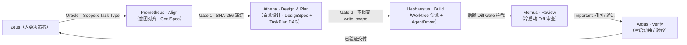

# Olympus4SWE

[English](README.md) | 简体中文

**以第一性原理驱动的 Agent-Native 全生命周期软件工程系统。**

Olympus4SWE 将**确定性 SDLC 控制面**（Python 3.13 + SQLite WAL + FastAPI）与**可插拔执行元框架（Meta-Harness）**（内置 `native` 循环 + 外部 `Pi` 编码 Agent 驱动）解耦结合，并通过双层 **Oracle Board + Ariadne** Web 工作台与无头 CLI 提供完整的人机协作闭环。

> **核心不变量：** LLM 负责提出规格、架构设计、任务规划、编写代码/测试与独立审查；确定性代码独占状态迁移、SHA-256 哈希绑定的人类审批、不相交 `write_scope` 的 DAG 校验、后置 `Diff Gate` 越界拦截、单调预算账本与有界返工收敛。

---

## 为什么做 Olympus4SWE

Olympus4SWE 不依赖重型黑盒编排框架，而是从第一性原理出发，直面 Agent 软件工程中 4 个不可简化的根本痛点：

1. **意图模糊 → 从一开始就做偏**：Stage 1（`Align`）先对仓库做只读取证，识别真正阻塞实现的歧义（可选冷启动并行多视角挑刺），在写第一行代码前先冻结经人类批准、含明确 `out_of_scope` 边界的 EARS 范式 `GoalSpec`。
2. **长程上下文衰减 & 并发修改互相踩踏**：Stage 2a（`Design`）先锁死白盒模块边界与跨模块接缝（`DesignSpec`），再由规划器生成经校验的 Task DAG，为并发节点分配严格不相交的 `write_scope`，在独立 `git worktree` 沙盒中执行并通过后置 `Diff Gate` 强校验。
3. **自写自审的确认偏误**：冷启动的 `Momus`（代码审查）与 `Argus`（独立验收）在**零共享历史上下文**的前提下，对照冻结契约审查代码 Diff 与可执行检查输出，强制按 `Important` / `Nit` 分级并受限于 `max_cycles=3` 收敛上限。
4. **过程黑盒、难以观测与中途纠偏**：每一次状态迁移、工具里程碑、Diff、交付检查与人工裁决都写入只追加 SQLite 事件表，并通过 SSE 实时投影到工作台；操作者可在运行中发送 `steer` 纠偏或安全暂停，不悄悄丢弃已有工作。

---

## 奥林匹斯众神分工与流水线



| 角色 | 职责定位 |
| :--- | :--- |
| **Zeus** *(人类操作者)* | 在目标 Workspace 下发 **Oracle**（`brownfield` / `greenfield` / `spec_only` × `feature` / `fix` / `refactor` / `blueprint`），回答澄清问题，并在哈希绑定闸门拍板审批。 |
| **Prometheus** *(Align)* | Stage 1 意图对齐：只读探测仓库事实、收敛阻塞歧义，并冻结人类确认的 `GoalSpec`。 |
| **Athena** *(Design & Plan)* | Stage 2a 架构与拆包：编写白盒 `DesignSpec`（模块边界、数据模型、接口契约）并将其分解为经依赖校验的 `TaskPlan` DAG。 |
| **Hephaestus** *(Build)* | Stage 2 编码执行：在隔离沙盒内通过配置的 `AgentDriver`（`auto` / `pi` / `native`）实现单个 `TaskNode`。 |
| **Momus** *(Review & Audit)* | 冷启动代码审查：独立审阅执行 Diff，区分 `Important` 与 `Nit` 缺陷并约束有界返工收敛。 |
| **Argus** *(Verify)* | 冷启动只读独立验收：对照上游冻结契约与隔离交付检查输出出具可审计的通过/拒绝结论。 |

**Web 工作台**基于同一份 SQLite 事件流提供两层协同视图：
- **L1 · Oracle Board**：支持多 Workspace 切换、按球权归属分列（`Awaiting Your Ruling` · `In Flight` · `Delivered`）、侧抽屉 **Quick Ruling Drawer** 原地澄清/审批，以及底部常驻五神席位栏 **Pantheon Dock**。
- **L2 · Ariadne Cockpit**：按需打开的 Oracle 深潜标签页，提供双图联动实时拓扑（Workflow Graph + Task DAG，基于 React Flow + ELK）、哈希绑定契约 Diff 审阅、任务矩阵、事件瀑布流与可拖拽检查器。

---

## 快速开始

### 环境要求

- **Python 3.13+**、[`uv`](https://docs.astral.sh/uv/) 与 **Git**
- **Node.js 22+ & `pnpm`** *（可选——仅在开发 `web/` 前端时需要；运行时 `olympus serve` 直接提供仓库内预构建静态资源，零 Node 依赖）*
- **Pi CLI** *（可选——安装后默认 `auto` 驱动会自动启用外部 `pi` Agent 执行器）*

### 1. 安装依赖

```bash
git clone https://github.com/kyrie21z/Olympus4SWE.git
cd Olympus4SWE
uv sync --locked
```

### 2. 配置 LLM Provider

Olympus4SWE 将厂商 SDK 隔离在数据驱动的 `ProviderRegistry` 与粘性故障转移 `CredentialPool` 之后。配置内置 `openai` 或 `anthropic` 环境变量即可直接运行：

```bash
# OpenAI 或任意 OpenAI-Compatible 网关
export OPENAI_API_KEY="sk-..."
# 可选覆盖项：
# export OPENAI_BASE_URL="https://your-gateway.example/v1"
# export OLYMPUS_MODEL="gpt-4o-mini"

# 或使用 Anthropic
export ANTHROPIC_API_KEY="sk-ant-..."
# export ANTHROPIC_BASE_URL="https://api.anthropic.com"
```

如需接入自定义 OpenAI-Compatible / Anthropic 网关、多 Key 池（`api_keys_env`）、自定义请求头或默认模型，可在 `~/.olympus/providers.json`、`<repo>/.olympus/providers.json` 或 `OLYMPUS_PROVIDERS_FILE` 指定的路径添加配置：

```json
{
  "providers": {
    "my-gateway": {
      "dialect": "openai-chat",
      "default_model": "my-model",
      "base_url": "https://gateway.example/v1",
      "api_key_env": "MY_GATEWAY_API_KEY",
      "default": true
    }
  }
}
```

### 3. 启动 Web 工作台

```bash
uv run olympus serve
```

在浏览器打开 **`http://127.0.0.1:8765`** 即可使用 **Oracle Board** 与 **Ariadne**（可通过 `--host`、`--port`、`--workspace /path/to/repo`、`--db` 自定义启动参数）。

---

## 工作流、CLI 与无头会话

### 内置声明式工作流

所有工作流以纯数据 YAML 定义在 `src/olympus/graph/workflows/` 下，可通过 `uv run olympus workflows` 查看：

| 工作流 | 拓扑策略 | 人工闸门 | 适用场景 |
| :--- | :--- | :--- | :--- |
| `full_sdlc_tdd` | `tdd_first` | 全闸门开启 | 完整 SDLC（`intake → align → critic → design → plan → execute`），采用 TDD 优先的垂直切片（tracer-bullet）推进。 |
| `product_blueprint` | `modular_product` | 全闸门开启 | 产出冻结的 `GoalSpec`、白盒 `DesignSpec` 与 Wave 0/1/2 `TaskPlan`，并在计划获批后停止（`stop_after: plan`）。 |
| `repo_fast_patch` | `minimal_patch` | 自动放行 | 面向仓库小型修复、CI 与脚本化调用的轻量单波次补丁闭环。 |

### 无头暂停/恢复会话 CLI（`olympus session`）

面向脚本、CI 与外部评测框架，`olympus session` 每次调用输出稳定、可机读的 `SessionEnvelope` JSON（`status`: `needs_input | completed | failed`；`pause_kind`: `clarify | approval | blocked | plan_handoff`）：

```bash
# 针对目标仓库发起一次工作流会话
uv run olympus session start "Add a /healthz JSON endpoint with tests" \
  --workspace /path/to/repo \
  --workflow full_sdlc_tdd

# 用自然语言回复澄清、批准或提出修订，继续推进已暂停的会话
uv run olympus session reply <run_id> "同意该规格，认证模块保持在范围之外。"
```

常用参数：`--step-mode plan_only|execute`、`--gate-policy default|interactive_minimal`、`--state-dir /path/outside/repo`、`--provider`、`--model`、`--base-url`。

### 分阶段直调 CLI

也可以逐阶段手动驱动与审计：

```bash
# Stage 1：意图对齐与 GoalSpec 冻结
uv run olympus align "Add rate limiting to the search API" --critique
uv run olympus clarify <run_id> --answer AMB-1="Per-IP sliding window"
uv run olympus approve-spec <run_id>

# Stage 2a & 2b：架构设计与任务 DAG 规划
uv run olympus design <run_id>
uv run olympus approve-design <run_id>
uv run olympus plan <run_id>
uv run olympus approve-plan <run_id>

# Stage 2c：在隔离 worktree 沙盒中执行并同步已验收改动
uv run olympus run <run_id> --apply

# 状态查询、事件回放与人工恢复
uv run olympus list
uv run olympus status <run_id>
uv run olympus events <run_id>
uv run olympus retry <run_id> <task_id> --revision <n> --hint "Fix edge case"
uv run olympus accept-risk <run_id> <task_id> --revision <n> --reason "Accepted with follow-up ticket"
```

---

## Meta-Harness：可插拔执行驱动

依据 [ADR-0002](docs/adr/0002-meta-harness-driver-and-watchdog.md)，Olympus4SWE 通过 `AgentDriver` 协议将确定性控制面与底层编码执行循环解耦：

- **默认 `auto` 解析**：`stage_driver`、`worker_driver` 与 `reviewer_driver` 默认均为 `auto`。当使用真实远程 Provider 且本机已安装 `pi` CLI 时，`auto` 自动启用 `pi`（`--mode rpc`、实时事件流、运行中 `steer`，并在规划/审查阶段锁定只读工具）；在离线单测或无 Node 环境下，`auto` 自动回退至纯 Python 内置 `native` 驱动。
- **按角色异构混搭**：支持通过 CLI 参数（`--stage-driver`、`--worker-driver`、`--reviewer-driver`）或环境变量（`OLYMPUS_STAGE_DRIVER`、`OLYMPUS_WORKER_DRIVER`、`OLYMPUS_REVIEWER_DRIVER`）按角色指定 `auto`、`pi`、`native` 或 `driver@model`：

```bash
uv run olympus run <run_id> \
  --worker-driver pi@gpt-4o \
  --reviewer-driver pi@claude-3-7-sonnet-latest
```

安装可选的 `Pi` 执行驱动：

```bash
npm install -g --ignore-scripts @earendil-works/pi-coding-agent
# 或通过 OLYMPUS_PI_BIN=/path/to/pi 指定可执行文件路径
```

---

## 架构与仓库结构

```text
Olympus4SWE/
├── src/olympus/
│   ├── core/          # 强类型 Pydantic 契约、SHA-256 指纹、DAG/写域校验、SQLite 存储、RunControl
│   ├── providers/     # 可插拔 LLM 注册表、粘性故障转移池、官方 OpenAI/Anthropic SDK 薄适配层
│   ├── tools/         # 强制绝对路径与输出截断的安全 ACI 文件/Shell 原语
│   ├── harness/       # Append-Only 循环、AgentDriver（native + pi）、DiffGate、worktree 沙盒、TurnReceipt
│   ├── stages/        # Stage 1 Align、Stage 2a Design、Stage 2 Orchestrate & Verify
│   ├── graph/         # 声明式 YAML 工作流加载器、黑板引擎、纯代码条件路由与进度投影
│   ├── session/       # 无头暂停/恢复运行器、闸门策略与自然语言回复路由
│   ├── web/           # FastAPI 服务、强类型 OpenAPI 契约（openapi.json）、SSE 实时流、RunSupervisor 与静态 SPA
│   └── cli/           # Typer CLI（olympus 与 olympus session）
├── web/               # React 19 + TypeScript + Vite 工作台源码（Oracle Board & Ariadne），消费生成式 OpenAPI 类型
├── tests/
│   ├── unit/          # 单元、契约、架构不变量、设计系统与 Playwright 浏览器 E2E 测试
│   └── evals/         # 独立评测套件、数据集、评分器与外部 Benchmark 适配器
├── benchmarks/
│   └── blacknote/     # 跨版本纵向全生命周期基准（BlackNote Dev）评分记录与归档产物
└── docs/
    ├── ARCHITECTURE.md
    └── adr/           # 架构决策记录（ADR-0001 .. ADR-0003）
```

### CI 机械守护的架构不变量

所有分层边界均由 [tests/unit/test_architecture_invariants.py](tests/unit/test_architecture_invariants.py) 与 [.github/workflows/ci.yml](.github/workflows/ci.yml) 在 CI 中自动强制检查：

- **纯净底座（`core/`）**：禁止导入同级 `olympus.*` 包、厂商 LLM SDK、Web/CLI 框架或 `tests`。
- **厂商 SDK 隔离**：仅 `src/olympus/providers/` 允许导入 `openai` 或 `anthropic`。
- **表现层解耦**：核心与运行时层严禁导入 `olympus.web`、`olympus.cli`、`fastapi`、`uvicorn` 或 `typer`。
- **评测独立性**：严格单向依赖（`tests/evals/ → src/olympus/`），生产代码绝不导入 `tests`。
- **前端契约纪律**：`web/src/` 下禁止无类型 `.js`/`.jsx` 源码；CI 自动校验 `web/src/api/schema.d.ts` 与 `src/olympus/web/static/` 与 `openapi.json` 及前端源码零漂移。

---

## 开发、验证与评测

### 后端质量门禁

```bash
uv run ruff check .
uv run mypy src
uv run pytest -q
```

### 前端开发（`web/`）

```bash
pnpm --dir web install --frozen-lockfile
pnpm --dir web generate:api   # 从 src/olympus/web/openapi.json 同步 TypeScript API 类型
pnpm --dir web typecheck
pnpm --dir web build          # 构建并同步静态资源至 src/olympus/web/static/
```

前端热重载开发时，在两个终端分别运行 `uv run olympus serve` 与 `pnpm --dir web dev`（详见 [web/README.md](web/README.md)）。

### 独立评测套件与纵向基准

`tests/evals/` 与生产代码严格解耦，支持离线 Mock 验证、真实 Provider 扫描及公开 Benchmark 接入（`ClarifyCodeBench`、`Ambig-SWE`、`SWE-Interact`、Harbor 交互桥接——数据集来源详见 [tests/evals/datasets/ATTRIBUTION.md](tests/evals/datasets/ATTRIBUTION.md)）：

```bash
# 仅校验数据集并估算调用上限（不调用模型）
uv run python -m tests.evals.run_eval --dry-run

# 离线脚本化 Stage 1 四类消融评测（baseline vs. critique）
uv run python -m tests.evals.run_eval --mock --variants baseline,critique

# 使用真实 Provider 运行在线评测
uv run python -m tests.evals.run_eval --live --provider openai --model gpt-4o-mini
```

跨版本全生命周期实测指标与可运行归档产物见 [benchmarks/blacknote/HISTORY.md](benchmarks/blacknote/HISTORY.md)。

---

## 相关文档与贡献指南

- **架构与第一性原理设计**：[docs/ARCHITECTURE.md](docs/ARCHITECTURE.md)
- **架构决策记录（ADR）**：
  - [ADR-0002：Meta-Harness `AgentDriver` 接缝、后置 `Diff Gate` 与双层 `Watchdog`](docs/adr/0002-meta-harness-driver-and-watchdog.md)
  - [ADR-0003：务实自研/选型边界（FastAPI + OpenAPI、统一 React/TS SPA 与官方 SDK 适配）](docs/adr/0003-pragmatic-foundation-fastapi-react-sdks.md)
- **核心领域术语表**：[GLOSSARY.md](GLOSSARY.md)
- **仓库技术指南与不变量**：[AGENTS.md](AGENTS.md)
- **团队协作与贡献流程**：[CONTRIBUTING.md](CONTRIBUTING.md)
- **前端工作台开发说明**：[web/README.md](web/README.md)

## 许可证

MIT License — 详见 [LICENSE](LICENSE)。
